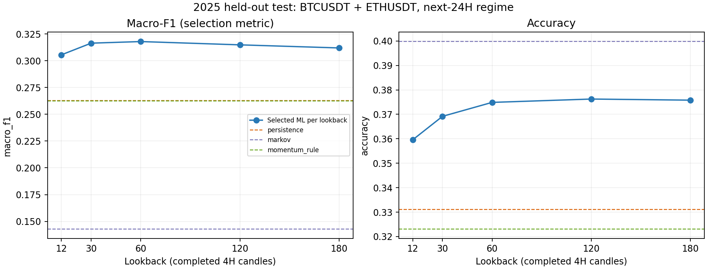
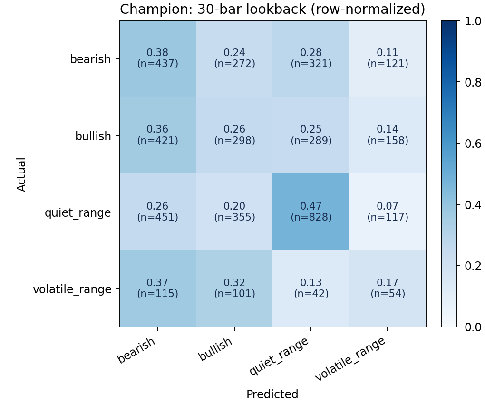

# Crypto 4H regime detection — held-out test results

## Outcome

The validation-selected model is **extra_trees** with **30 completed 4H candles (5 days)** of lookback and **full** features. It beats the strongest test baseline by **+5.36 macro-F1 percentage points**. Selection used validation data only; the test baseline ranking is reported for comparison, not used to choose the model.

**Important accuracy caveat:** champion accuracy is 36.92%, below the majority/Markov baselines at 39.98%. It improves macro-F1 and balanced accuracy, but does not beat those simple baselines on raw accuracy or log loss; the paired accuracy interval versus persistence includes zero. The fixed selection objective was validation macro-F1 to avoid choosing a model that ignores minority regimes. Results are reported without test-driven tuning.

- **Test accuracy:** 36.92%
- **Balanced accuracy:** 32.03%
- **Macro-F1:** 0.3164
- **Log loss:** 1.2785
- **Multiclass Brier score:** 0.6952
- **Test rows:** 4,380 pooled BTC/ETH decisions (2,190 per asset)
- **Decision period:** 2025-01-01T00:00:00+00:00 through 2025-12-31T20:00:00+00:00
- **Final label resolves:** 2026-01-01T20:00:00+00:00

## What is being detected?

At every 4-hour close, classify the **next 24 hours** into one of four fixed, mutually exclusive regimes. This is forward regime classification, not a claim to know an unobservable 'true' market state or a price/profit forecast.

Let `sigma` be RMS of the previous 42 one-candle log returns, `R` the next-six-candle net log return, and `V` the RMS of those six future returns. With `z = R / (sigma * sqrt(6))`:

- **bearish:** z <= -0.5
- **bullish:** z >= +0.5 (checked after bearish; boundaries are disjoint)
- **volatile_range:** neither directional condition, and V/sigma >= 1
- **quiet_range:** neither directional condition, and V/sigma < 1

The label uses future prices only to construct the training/evaluation target. Those future quantities are never model inputs. Thresholds and the 24-hour horizon are fixed across all lookbacks, so the comparison uses identical targets and rows.

## Lookback comparison — untouched 2025 test year

Each row refits that lookback's validation-selected specification on 2018–2024. The overall champion was chosen before test evaluation.
| lookback | lookback_days | selected_model | n | accuracy | balanced_accuracy | macro_f1 | log_loss |
| --- | --- | --- | --- | --- | --- | --- | --- |
| 12 | 2 | extra_trees / full | 4380 | 0.3596 | 0.3072 | 0.3055 | 1.2867 |
| 30 | 5 | extra_trees / full | 4380 | 0.3692 | 0.3203 | 0.3164 | 1.2785 |
| 60 | 10 | extra_trees / full | 4380 | 0.3749 | 0.3201 | 0.3179 | 1.2713 |
| 120 | 20 | extra_trees / full | 4380 | 0.3763 | 0.3155 | 0.3148 | 1.2696 |
| 180 | 30 | extra_trees / full | 4380 | 0.3758 | 0.3113 | 0.3119 | 1.2667 |

## Baselines — identical test rows

| model | accuracy | balanced_accuracy | macro_f1 | log_loss |
| --- | --- | --- | --- | --- |
| majority | 0.3998 | 0.2500 | 0.1428 | 1.2589 |
| persistence | 0.3311 | 0.2628 | 0.2628 | 24.1114 |
| momentum_rule | 0.3231 | 0.2620 | 0.2624 | 24.3994 |
| markov | 0.3998 | 0.2500 | 0.1428 | 1.2548 |

`majority` learns the training class mode. `persistence` repeats the immediately preceding completed 24H regime. `momentum_rule` applies the target's economic rule to the preceding window. `markov` learns a smoothed 4×4 transition matrix on training data only. Logistic regression is also included in the model search as a regularized linear learned baseline.

## Per-asset champion results

| symbol | n | accuracy | balanced_accuracy | macro_f1 | log_loss |
| --- | --- | --- | --- | --- | --- |
| BTCUSDT | 2190 | 0.3639 | 0.3160 | 0.3144 | 1.2799 |
| ETHUSDT | 2190 | 0.3744 | 0.3254 | 0.3180 | 1.2771 |

## Champion per-class results

| regime | precision | recall | f1 | support |
| --- | --- | --- | --- | --- |
| bearish | 0.3069 | 0.3797 | 0.3394 | 1151 |
| bullish | 0.2904 | 0.2556 | 0.2719 | 1166 |
| quiet_range | 0.5595 | 0.4729 | 0.5125 | 1751 |
| volatile_range | 0.1200 | 0.1731 | 0.1417 | 312 |

Confusion matrix (rows actual, columns predicted; order: bearish, bullish, quiet_range, volatile_range):

```text
[[437 272 321 121]
 [421 298 289 158]
 [451 355 828 117]
 [115 101  42  54]]
```

## Uncertainty: paired time-block bootstrap

Whole decision timestamps are resampled in seven-day moving blocks, keeping BTC and ETH together. This preserves cross-asset dependence and exceeds the six-candle label overlap. These intervals describe this historical sample, not a guarantee over future market regimes.

Versus **persistence** (2,000 repetitions):
- macro_f1_delta: 95% interval [+0.0223, +0.0845]
- accuracy_delta: 95% interval [-0.0037, +0.0760]
- balanced_accuracy_delta: 95% interval [+0.0274, +0.0896]

## Data and leakage controls

- Real Binance-spot BTCUSDT and ETHUSDT one-minute candles from pinned third-party GitHub archives; this is not an exchange-certified dataset, and the source repositories do not report a data license.
- Raw archives/processed price files are not redistributed; review third-party source terms before reuse.
- Source commits, monthly CSV hashes, archive hashes and processed-data hashes: [`data/manifest.json`](../data/manifest.json).
- 240 distinct, valid, aligned minutes required per 4H candle; OHLC aggregated correctly and volumes/counts summed. No filled candles.
- Invalid/padding records and incomplete candles rejected. Missing grid slots remain missing; rolling windows never bridge them silently.
- Asset-local, right-aligned features; no raw price level, centered rolling window, global normalization, future return or target-derived feature.
- Lookbacks include their indicator warm-up and nested windows within the stated candle budget. All lookbacks use the same eligible rows.
- Expanding validation folds: 2023H1, 2023H2, 2024H1, 2024H2. Training labels must resolve before each validation fold begins.
- Final training includes 2018–2024, purged so no label reaches into the test decision period. No random train/test split.
- Model family, feature ablation and lookback selected by pooled validation macro-F1; accuracy then negative log loss break ties.
- Median imputation/scaling (where needed) fitted inside each training fold. BTC and ETH are pooled only after causal feature construction.
- Test is evaluated after selection is frozen. All lookback test results are published, not just the winner.

## Validation search

30 specifications; four expanding folds each; 5 lookbacks. Full fold metrics and out-of-fold predictions are saved. The table shows each lookback's selected specification.
| lookback | model | feature_set | feature_count | validation_macro_f1 | validation_accuracy |
| --- | --- | --- | --- | --- | --- |
| 12 | extra_trees | full | 101 | 0.3238 | 0.3831 |
| 30 | extra_trees | full | 219 | 0.3300 | 0.3899 |
| 60 | extra_trees | full | 247 | 0.3267 | 0.3862 |
| 120 | extra_trees | full | 275 | 0.3222 | 0.3839 |
| 180 | extra_trees | full | 331 | 0.3116 | 0.3740 |

## Figures





## Reproducibility and limits

See the [README](../README.md) and [methodology](../docs/METHODOLOGY.md). Run `python -m regime_detection train` to rebuild data and reproduce the experiment, or `python -m regime_detection report` to regenerate this report from saved metrics. The trained validation-champion model is `results/models/regime_model.joblib`.

This benchmark classifies an explicit operational regime definition on two correlated assets. It is not independent cross-market validation, not proof of causal market-state discovery, and not a trading-profit backtest. Volatile range is a minority class; macro-F1 and per-class recall are therefore important. A favorable historical test does not guarantee future accuracy. No result here was selected or tuned using the test set.

Environment: Python 3.11.2, scikit-learn 1.6.1, LightGBM 4.6.0, pandas 2.2.3, NumPy 2.2.6.
